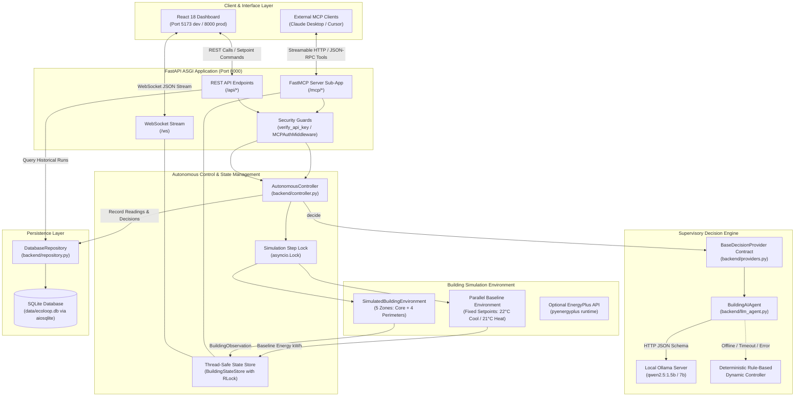
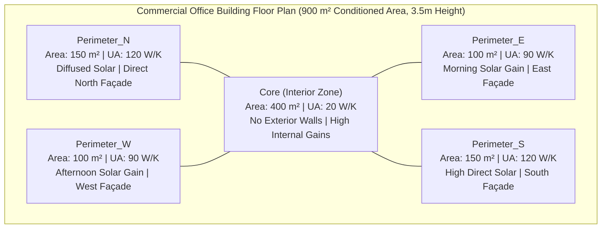
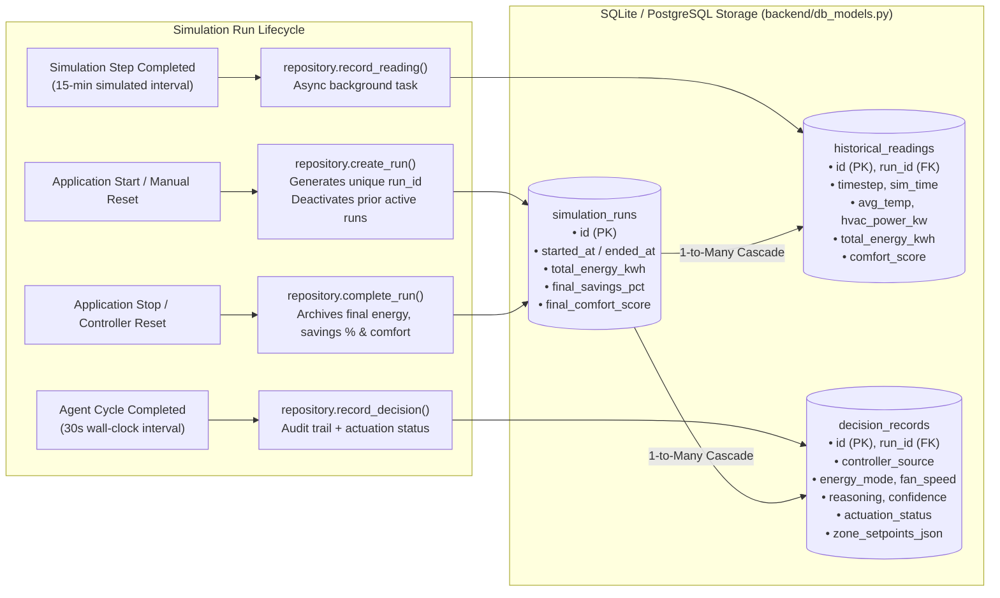

# Eco-Loop Building Agents

[](https://www.python.org/)
[](https://fastapi.tiangolo.com/)
[](https://react.dev/)
[](https://ollama.com/)
[](https://modelcontextprotocol.io/)
[](https://www.sqlalchemy.org/)
[](LICENSE)

> **Research prototype for building HVAC supervisory control, comfort estimation, and Model Context Protocol (MCP) tooling**

Current verification and unresolved integration limits: [project audit, 26 November 2026](docs/project_audit_2026-11-26.md).

---

## Table of Contents

- [Overview](#overview)
- [System Architecture](#system-architecture)
- [Control Cycle](#control-cycle)
- [Decision Providers](#decision-providers)
- [Building Simulation Model](#building-simulation-model)
- [Safety and Constraint Enforcement](#safety-and-constraint-enforcement)
- [Persistence and Historical Data](#persistence-and-historical-data)
- [MCP Tool Interface](#mcp-tool-interface)
- [REST API Reference](#rest-api-reference)
- [WebSocket Interface](#websocket-interface)
- [Dashboard](#dashboard)
- [Benchmark Evaluation](#benchmark-evaluation)
- [Installation & Quick Start](#installation--quick-start)
- [Configuration Reference](#configuration-reference)
- [Project Structure](#project-structure)
- [Testing](#testing)
- [Limitations and Future Work](#limitations-and-future-work)
- [License](#license)

---

## Overview

Heating, Ventilation, and Air Conditioning (HVAC) systems account for approximately 40% of primary energy consumption in commercial buildings. In standard practice, building automation systems (BAS) operate on static time-of-day schedules and fixed thermostat setpoints. These rigid setpoints fail to adapt dynamically to occupancy swings, fluctuating solar radiation, and variable weather conditions, leading to significant energy waste and periodic occupant discomfort.

**Eco-Loop Building Agents** is an engineering prototype and research simulation testbed that demonstrates autonomous closed-loop HVAC supervisory control. The system couples a multi-zone physics simulation with local large language model (LLM) inference and deterministic control theory.

### Core Capabilities

1. **Autonomous Supervisory Control**: An asynchronous control loop samples simulation telemetry, formats a structured operational context, and requests setpoint decisions at regular intervals.
2. **Dual-Path Decision Architecture**: Supervisory control decisions are generated via local open-source LLMs (`qwen2.5:1.5b` or `qwen2.5:7b` executed locally via Ollama) with schema-validated JSON outputs, backed by a deterministic rule-based controller that activates whenever the LLM is unavailable, times out, or produces malformed syntax.
3. **Multi-Zone Physics Engine**: An integrated Python simulation models a 5-zone commercial office building (Core, North, South, East, and West perimeter zones) incorporating realistic thermal mass, multi-wall envelope conductance, diurnal/seasonal solar gains, dynamic internal loads, and an ISO 7730 / Fanger PMV/PPD thermal comfort model.
4. **Parallel Reference Baseline**: The environment continuously steps an identical, parallel reference building running static setpoints (22.0°C cooling / 21.0°C heating) subjected to the exact same weather and occupancy seeds, delivering an empirical, apple-to-apple calculation of energy savings.
5. **Model Context Protocol (MCP) Integration**: The backend mounts an embedded FastMCP server exposing 10 standardized inspection and control tools, allowing external agents (such as Claude Desktop, Cursor, or autonomous agent frameworks) to monitor state and actuate setpoints over Streamable HTTP at `/mcp/`.
6. **Control Constraints**: Setpoint changes pass through canonical range checks, mandatory 1.5°C deadband verification, slew-rate clamping (maximum 2.0°C modification per command/cycle), and a simulation lock (`step_lock`) to serialize stepping and actuation.
7. **Async Persistence & Telemetry Streaming**: Comprehensive simulation run records, timestep telemetry, and agent decision audits are persisted via an asynchronous SQLAlchemy 2.0 layer (SQLite/PostgreSQL) and broadcast to a reactive React 18 dashboard via WebSockets.
8. **Forecasts, Fans, and Manual Holds**: Scheduled and forecast/tariff-aware providers complement hybrid control. The simulator models fan electricity and ventilation. Timed manual holds protect acknowledged zone setpoints until expiry or explicit release.
9. **History and Monitoring**: Saved runs support comparison, replay, decision inspection, and CSV export. Optional BACnet/IP and Modbus/TCP adapters read explicitly mapped points without writing to physical devices.

> [!NOTE]
> **Engineering Scope & Prototype Status**: Eco-Loop is a software simulation and architectural proof-of-concept developed as an engineering benchmark. It is not connected to physical building automation hardware (e.g., BACnet/Modbus trunks), has not undergone field trials in an occupied commercial building, and is not an officially certified product or endorsement of Honeywell International Inc.

---

## System Architecture

Eco-Loop is structured as a decoupled, multi-tier asynchronous application. The FastAPI backend serves as the central coordination hub, orchestrating background simulation tasks, decision provider queries, telemetry persistence, WebSocket broadcasting, and FastMCP tool dispatching.



### Component Roles

- **React Dashboard (`frontend/src/`)**: A single-page application built with Vite, React 18, TailwindCSS, Chart.js, and Lucide icons. Subscribes to `/ws` for live telemetry, renders thermal and electrical trends, visualizes PMV/PPD comfort zones, exposes manual setpoint sliders, and enables simulation speed and reset controls.
- **FastAPI Core (`backend/app.py`)**: Manages the application lifespan, registers CORS, mounts the static frontend distribution (`frontend/dist`), configures security middleware, and coordinates startup/shutdown routines for the controller and database engine.
- **Autonomous Controller (`backend/controller.py`)**: Singleton orchestrator managing two concurrent async background loops:
  - `_simulation_loop`: Steps the physics engine forward at the configured `SPEEDUP_FACTOR`.
  - `_agent_loop`: Invokes the decision provider every `AGENT_INTERVAL_SECONDS` (default: 30s) and applies setpoint modifications under `step_lock`.
- **State Store (`backend/state.py`)**: In-memory, thread-safe repository guarded by a reentrant lock (`threading.RLock`). Holds the active `BuildingObservation`, last `AgentDecision`, running metrics summary, and an in-memory ring buffer (`deque`) of recent historical readings. Notifies subscribers via an `asyncio.Event`.
- **Decision Engine (`backend/providers.py` & `backend/llm_agent.py`)**: Implements an abstract provider contract (`BaseDecisionProvider`). Queries local LLM inference via Ollama or executes deterministic setback algorithms.
- **Physics Simulation (`backend/energyplus_runner.py`)**: Concrete implementation of `BuildingEnvironment`. Simulates a 5-zone commercial building with transient thermal mass, internal loads, solar radiation, envelope conduction, and HVAC heat balance. Steps an identical parallel baseline environment (`is_baseline=True`) for matched synthetic performance comparisons.
- **MCP Server (`backend/mcp_server.py`)**: Embedded FastMCP application exposing 10 standardized tools for introspection, setpoint manipulation, and step execution over Streamable HTTP at `/mcp/`.
- **Data Repository (`backend/repository.py` & `backend/db_models.py`)**: Asynchronous data access layer backed by SQLAlchemy 2.0 and `aiosqlite`. Records discrete simulation run lifecycles, full timestep telemetry, and agent decision audit records.

---

## Control Cycle

The autonomous control system executes two asynchronous, decoupled loops:

1. **Simulation Stepping Loop**: Advances the building thermodynamic model by one 15-minute timestep at intervals determined by `TIMESTEP_MINUTES * 60 / SPEEDUP_FACTOR` wall-clock seconds. At the default 60.0× speedup, each 15-minute simulation timestep advances every 15.0 wall-clock seconds.
2. **Supervisory Agent Loop**: Executes every `AGENT_INTERVAL_SECONDS` (default: 30.0 wall-clock seconds), evaluating building conditions, selecting optimal setpoints, and actuating zone thermostats.

### Detailed Cycle Sequence

```mermaid
flowchart TD
    StartCycle(["Start Control Cycle (Every AGENT_INTERVAL_SECONDS)"]) --> ReadState["Acquire latest BuildingObservation from StateStore"]
    ReadState --> CheckProv{"Check Provider Readiness"}

    CheckProv -->|LLM Verified Available| CallLLM["Format Observation Snapshot Context<br/>Call Ollama Async (temperature=0.1, timeout=60s)"]
    CheckProv -->|LLM Known Offline| ExecRule["Execute Deterministic Rule-Based Algorithm<br/>controller_source = 'rule_based'"]

    CallLLM --> LLMOutcome{"LLM Response Valid?"}
    LLMOutcome -->|Success (Valid JSON Schema)| ParseLLM["Parse & Validate JSON against AgentDecision<br/>controller_source = 'llm'"]
    LLMOutcome -->|Timeout / Exception / Corrupt JSON| TriggerFallback["Catch Exception & Fall Back to Rule Engine<br/>controller_source = 'fallback'"]

    TriggerFallback --> ExecRule

    ParseLLM --> SafetyCheck["Run _validate_decision:<br/>Clamp bounds & enforce 2°C cooling-heating deadband"]
    ExecRule --> SafetyCheck

    SafetyCheck --> AcquireLock["Acquire controller.step_lock"]
    AcquireLock --> SlewLimit["Apply _clamp_setpoint_slew:<br/>Limit delta to max 2.0°C/cycle against current setpoints<br/>Ensure target_cool >= target_heat + 1.5°C"]

    SlewLimit --> Actuate["Apply clamped setpoints to active environment<br/>env.set_setpoint(zone, cool, heat)"]
    Actuate --> UpdateStateCache["Update StateStore cached setpoints & observation"]
    UpdateStateCache --> ReleaseLock["Release controller.step_lock"]

    ReleaseLock --> AuditLog["Asynchronously persist decision record to SQLite DB<br/>repository.record_decision(...)"]
    AuditLog --> NotifyWS["Notify StateStore async event & broadcast to WebSocket clients"]
    NotifyWS --> SleepCycle["Sleep until next control interval"]
    SleepCycle --> StartCycle
```

### Execution Steps

1. **Telemetry Sampling**: The controller reads the latest `BuildingObservation` from `state_store.get_observation()`. If the simulation has not yet stepped, the loop yields briefly.
2. **Context Compilation**: Historical trends (up to 10 previous readings), outdoor ambient temperature, solar exposure, occupancy ratio, current zone temperatures, and active setpoints are assembled into a structured prompt.
3. **Provider Invocation**: The controller delegates to `self.provider.decide(obs, history)`. If `BuildingAIAgent` is configured:
   - Ollama availability and model existence are checked (cached for 30s to avoid latency overhead).
   - If available, `client.chat` is invoked using structured outputs (`format=AgentDecision.model_json_schema()`).
   - If Ollama is unreachable, times out (after `LLM_TIMEOUT_SECONDS = 60s`), or returns malformed syntax, the agent catches the error and executes `_rule_based_decision(obs)`.
4. **Safety Envelope Clamping**:
   - `_validate_decision` clamps cooling and heating to configured bounds. Gaps of 1.5°C or less are widened to 2.0°C; canonical actuation subsequently requires at least 1.5°C. Missing zones are populated from the current observation.
5. **Actuator Slew-Rate Limiting & Actuation**:
   - The controller acquires `controller.step_lock`.
   - `_clamp_setpoint_slew` compares requested setpoints against current zone setpoints, restricting the maximum rate of change to **$\pm 2.0^\circ\text{C}$ per control cycle**.
   - Clamped setpoints are applied to the simulation environment via `env.set_setpoint(zone, cool, heat)` and cached in `state_store.update_setpoint()`.
6. **Audit Trail Persistence**: The actuation status (`applied`, `partial`, `failed`, `held`, or `queued`), reasoning, confidence, acknowledged setpoints, and timestamp are recorded via `repository.record_decision()`. `queued` marks an EnergyPlus command awaiting later engine telemetry.
7. **Telemetry Broadcast**: The `state_store` triggers its async event, prompting the background `broadcast_loop()` to serialize a `DashboardUpdate` message to all connected WebSocket clients.

---

## Decision Providers

To decouple high-level supervisory intelligence from the physical simulation and API layers, Eco-Loop implements a formal provider interface in `backend/providers.py`.

```mermaid
flowchart TD
    subgraph ProviderContract ["Abstract Provider Interface (backend/providers.py)"]
        BaseProvider["BaseDecisionProvider (ABC)<br/>• name: str<br/>• decide(obs, history) -> AgentDecision<br/>• check_availability(force) -> bool"]
    end

    subgraph ConcreteProviders ["Provider Implementations"]
        RuleBasedProvider["RuleBasedProvider<br/>• Occupancy-based setback logic<br/>• Outdoor temperature compensation<br/>• PMV comfort correction<br/>• controller_source = 'rule_based'"]
        OllamaProvider["OllamaProvider<br/>• Structured JSON Schema output<br/>• Configurable host, model, timeout<br/>• controller_source = 'llm'"]
        BuildingAIAgent["BuildingAIAgent (backend/llm_agent.py)<br/>• Implements BaseDecisionProvider<br/>• Bounded retries (2 attempts)<br/>• Model availability health probe<br/>• Internal fallback recovery routing"]
    end

    subgraph ControllerIntegration ["Autonomous Controller (backend/controller.py)"]
        ControllerRef["AutonomousController.provider<br/>Defaults to singleton 'agent'"]
    end

    BaseProvider <|-- RuleBasedProvider
    BaseProvider <|-- OllamaProvider
    BaseProvider <|-- BuildingAIAgent

    ControllerRef -->|calls .decide()| BaseProvider

    BuildingAIAgent -->|If Ollama available & healthy| DirectOllama["Ollama AsyncClient.chat<br/>(qwen2.5:1.5b / 7b)"]
    BuildingAIAgent -->|If connection lost or offline| RuleFallback["_rule_based_decision(obs)<br/>controller_source = 'rule_based'"]
    DirectOllama -->|On error / timeout / schema failure| ErrorFallback["_rule_based_decision(obs)<br/>controller_source = 'fallback'"]
```

### The `BaseDecisionProvider` Interface

Every decision provider inherits from `BaseDecisionProvider` and must implement three members:

```python
class BaseDecisionProvider(ABC):
    @property
    @abstractmethod
    def name(self) -> str:
        """Provider identifier."""
        ...

    @abstractmethod
    async def decide(
        self,
        obs: BuildingObservation,
        history: Optional[List[HistoryEntry]] = None,
    ) -> AgentDecision:
        """Generate supervisory setpoints and fan speed control decision."""
        ...

    @abstractmethod
    async def check_availability(self, force: bool = False) -> bool:
        """Check operational readiness of the provider."""
        ...
```

### Provider Implementations

#### 1. `BuildingAIAgent` (`backend/llm_agent.py`)
The default provider instantiated by the application singleton. It manages communication with a local Ollama server over HTTP:
- **System Prompt**: Directs the LLM to act as a building automation engineer balancing ASHRAE 55 thermal comfort against energy conservation.
- **Structured Outputs**: Formulates the prompt with JSON schema enforcement (`format=AgentDecision.model_json_schema()`), constraining model output strictly to the Pydantic definition.
- **Fault Recovery**: Implements bounded retry logic (2 attempts with 1-second backoff). If inference fails, times out, or yields invalid JSON, it catches the exception and immediately invokes `_rule_based_decision(obs)`.

#### 2. `RuleBasedProvider` (`backend/providers.py`) & `_rule_based_decision`
A deterministic, rule-based algorithm operating on thermodynamic heuristics:
- **Outdoor Ambient Compensation**: If outdoor temperature exceeds 28.0°C, cooling setpoints increment by 0.5°C to alleviate chiller stress. If outdoor temperature drops below 0.0°C, heating setpoints decrement by 0.5°C.
- **Occupancy Setbacks**: When occupancy falls below 20% (unoccupied or night hours), the deadband is widened: cooling increases by +1.0°C (up to 30.0°C) and heating decreases by -1.0°C (down to 16.0°C).
- **PMV Comfort Correction**: If zone Predicted Mean Vote ($PMV$) drifts above +1.0 (too warm), cooling setpoint is lowered by 0.5°C. If $PMV$ falls below -1.0 (too cool), heating setpoint is raised by 0.5°C.
- **Deadband Maintenance**: Ensures $T_{\text{cool}} \ge T_{\text{heat}} + 1.5^\circ\text{C}$ across all zones.

#### 3. `OllamaProvider` (`backend/providers.py`)
A modular provider allowing custom LLM configurations (host, model, temperature, timeout) to be injected directly into `AutonomousController(provider=...)` for benchmarking or alternate model testing.

#### 4. `ScheduledProvider` and `ForecastProvider` (`backend/providers.py`)

`CONTROL_PROVIDER=scheduled` uses occupied/unoccupied setpoints. `forecast` adds synthetic weather and occupancy forecasts, configured time-of-use rates, and PMV corrections. It is a deterministic heuristic, not a calibrated model-predictive optimizer. The default `hybrid` uses `BuildingAIAgent`; `rule_based` runs the deterministic provider without querying Ollama. `controller_source` also records `scheduled` and `forecast` when those providers generate a decision.

### Attribution of `controller_source`

Every generated `AgentDecision` contains a `controller_source` field that explicitly identifies which logic path produced the setpoints:

| `controller_source` Value | Trigger Condition | Reasoning Prefix |
|---|---|---|
| `"llm"` | Successful inference via Ollama returning valid JSON schema | Direct LLM reasoning text |
| `"rule_based"` | Provider determined Ollama was offline or model was missing prior to calling inference | `"[Rule-based] ..."` |
| `"fallback"` | Ollama was online and attempted, but failed due to timeout, network disconnection, HTTP error, or malformed JSON | `"[Fallback] ..."` |

---

## Building Simulation Model

When `SIMULATION_MODE=true` (the default), Eco-Loop runs an internal, physics-based multi-zone thermodynamic simulator (`SimulatedBuildingEnvironment` in `backend/energyplus_runner.py`). This eliminates the requirement for a local EnergyPlus installation using a simplified thermal model with explicit assumptions.



### Zone Geometries & Physical Properties

The building model represents a single floor of a typical medium-sized commercial office building with 900 m² total conditioned floor area and a ceiling height of 3.5 m:

| Zone Identifier | Floor Area | Envelope UA | Peak Solar Exposure | Thermal Mass ($C_{\text{th}}$) |
|---|---|---|---|---|
| `Core` | 400.0 m² | 20.0 W/K | Interior (minimal indirect solar) | $50.8 \times 10^6 \text{ J/K}$ |
| `Perimeter_N` | 150.0 m² | 120.0 W/K | North façade (diffuse daylighting) | $19.0 \times 10^6 \text{ J/K}$ |
| `Perimeter_S` | 150.0 m² | 120.0 W/K | South façade (intense direct solar) | $19.0 \times 10^6 \text{ J/K}$ |
| `Perimeter_E` | 100.0 m² | 90.0 W/K | East façade (morning solar peak) | $12.7 \times 10^6 \text{ J/K}$ |
| `Perimeter_W` | 100.0 m² | 90.0 W/K | West façade (afternoon solar peak) | $12.7 \times 10^6 \text{ J/K}$ |

### Thermal Mass & Energy Balance Model

Zone temperature changes are computed using a lumped-capacitance heat balance model over timestep $\Delta t$ (900 seconds):

$$\Delta T_z = \frac{\sum Q_z \cdot \Delta t}{C_{\text{th}, z}}$$

Where the effective thermal capacitance $C_{\text{th}, z}$ accounts for the air volume, concrete floor slabs, drywall partitions, furniture, and internal equipment:

$$C_{\text{th}, z} = \rho_{\text{air}} \cdot C_{p, \text{air}} \cdot A_z \cdot H \cdot M_{\text{mass}}$$

With constants:
- $\rho_{\text{air}} = 1.204 \text{ kg/m}^3$ (dry air density at 20°C)
- $C_{p, \text{air}} = 1005.0 \text{ J/(kg}\cdot\text{K)}$ (specific heat capacity of air)
- $H = 3.5 \text{ m}$ (floor-to-ceiling height)
- $M_{\text{mass}} = 30.0$ (`THERMAL_MASS_MULTIPLIER` correction factor, yielding an effective thermal capacitance of $\approx 127 \text{ kJ/(m}^2\cdot\text{K)}$ typical of medium-weight commercial construction)

The net heat flow $\sum Q_z$ comprises four components:

$$\sum Q_z = Q_{\text{solar}} + Q_{\text{internal}} + Q_{\text{envelope}} + Q_{\text{hvac}}$$

1. **Solar Gains ($Q_{\text{solar}}$)**: Calculated orientation-specifically per zone using diurnal solar tracking. The East zone peaks before noon ($65 \text{ W/m}^2$), West peaks after 12:00 ($65 \text{ W/m}^2$), South receives sustained high radiation ($85 \text{ W/m}^2$), and North receives diffuse radiation ($28 \text{ W/m}^2$).
2. **Internal Gains ($Q_{\text{internal}}$)**:
   - Lighting: $9.0 \text{ W/m}^2$ (ASHRAE 90.1 LED office lighting).
   - Plug Loads / Equipment: $10.0 \text{ W/m}^2 \times (0.3 + 0.7 \times \text{occupancy})$.
   - Occupants: $75.0 \text{ W/person} \times A_z \times 0.07 \text{ persons/m}^2 \times \text{occupancy}$ (sensible metabolic heat).
3. **Envelope Conductance ($Q_{\text{envelope}}$)**: Heat transfer through exterior walls and windows governed by overall thermal conductance: $Q_{\text{envelope}} = -UA_z \cdot (T_z - T_{\text{outdoor}})$.
4. **HVAC Heat Transfer ($Q_{\text{hvac}}$)**:
   - Proportional controller with a 0.5°C deadband around active setpoints.
   - If $T_z > T_{\text{cool}} + 0.5^\circ\text{C}$: Proportional cooling up to $80 \text{ W/m}^2$ maximum capacity. Electrical power is computed using a cooling Coefficient of Performance $\text{COP}_{\text{cooling}} = 3.5$.
   - If $T_z < T_{\text{heat}} - 0.5^\circ\text{C}$: Proportional heating up to $60 \text{ W/m}^2$ maximum capacity. Electrical power is computed assuming electric resistance heating with $\text{COP}_{\text{heating}} = 1.0$.

### Thermal Comfort Model (ISO 7730 / Fanger PMV & PPD)

Comfort metrics are estimated per zone using a Fanger-style heat balance calculation with these assumptions:
- Mean radiant temperature is approximated as $T_r = T_a + 0.5^\circ\text{C}$.
- Metabolic rate is set to $1.1 \text{ met}$ ($63.96 \text{ W/m}^2$, light office activity).
- Clothing insulation is set to $0.7 \text{ clo}$ ($0.1085 \text{ m}^2\text{K/W}$, typical business attire).
- Internal heat balance is iteratively solved for clothing outer surface temperature ($t_{cl}$) using a 10-step Newton-Raphson numerical solver.
- Yields the Predicted Mean Vote ($PMV$, range $[-3.0, +3.0]$) and Predicted Percentage of Dissatisfied occupants ($PPD$, range $[5.0\%, 100.0\%]$).
- The reported neutral comfort target is $|PMV| \le 0.5$. This is a model metric; full ASHRAE Standard 55 compliance also requires conditions and assessments outside this prototype.

### Parallel Fixed-Setpoint Reference Baseline

A major methodological challenge in building AI evaluation is accurately isolating controller efficiency from weather and occupant variability. Eco-Loop solves this by instantiating a parallel reference environment:
- During startup, `AutonomousController` creates `self.baseline_env = SimulatedBuildingEnvironment(is_baseline=True)`.
- The baseline environment initializes setpoints to fixed standard values: **Cooling 22.0°C / Heating 21.0°C**.
- When `is_baseline=True`, `set_setpoint()` **rejects setpoint and fan modification commands**, preserving its fixed reference settings.
- In every simulation step, both environments advance in parallel using identical weather inputs, solar sequences, and occupancy schedules.
- Realized energy savings are computed directly from measured energy consumption:
  $$\text{Savings } (\%) = \frac{E_{\text{baseline}} - E_{\text{controlled}}}{E_{\text{baseline}}} \times 100.0$$

### Fault Injection & Sensor Anomaly Engine

`SimulatedBuildingEnvironment` provides built-in hooks for testing fault tolerance and edge cases:
- `inject_sensor_fault(zone, value)`: Simulates disconnected sensors (`-999.0°C`), electrical noise, or dropped packets (`NaN`). If the environment detects a reading $T < 5.0^\circ\text{C}$, $T > 45.0^\circ\text{C}$, or `math.isnan(T)`, it flags `sensor_fault = True`, stores the anomalous value in `raw_temperature`, and imputes a safe operating value using the mean of all healthy zones (or 21.5°C fallback).
- `inject_weather_override(temp, humidity)`: Overrides the weather model to simulate severe extremes, such as a -20.0°C polar freeze or a +45.0°C heatwave.
- `inject_occupancy_override(occupancy)`: Simulates sudden occupancy spikes or evacuations.

---

## Safety and Constraint Enforcement

To safeguard building mechanical equipment from short-cycling, thermal shock, or invalid supervisory commands, Eco-Loop enforces a multi-layer defense-in-depth safety architecture:

```mermaid
flowchart TD
    IncomingCommand["Setpoint Command Received<br/>(REST POST /api/setpoint, MCP tool, or AI Decision)"] --> Phase1{"Phase 1: Canonical Validation<br/>(validate_setpoints)"}

    Phase1 -->|Zone Unknown| RejectZone["Raise ValueError: Unknown zone<br/>Return HTTP 422 / MCP Error"]
    Phase1 -->|Cooling < 20°C or > 30°C| RejectCool["Raise ValueError: Cooling outside [20, 30]°C<br/>Return HTTP 422 / MCP Error"]
    Phase1 -->|Heating < 16°C or > 22°C| RejectHeat["Raise ValueError: Heating outside [16, 22]°C<br/>Return HTTP 422 / MCP Error"]
    Phase1 -->|Cooling < Heating + 1.5°C| RejectDeadband["Raise ValueError: Deadband < 1.5°C<br/>Return HTTP 422 / MCP Error"]

    Phase1 -->|Passes Canonical Rules| Phase2["Phase 2: Slew-Rate Limiting<br/>(_clamp_setpoint_slew)"]

    Phase2 --> FetchCurr["Query current active zone setpoints from StateStore"]
    DeltaClamp["Clamp maximum change per cycle:<br/>target_cool = clamp(cool, curr_cool - 2°C, curr_cool + 2°C)<br/>target_heat = clamp(heat, curr_heat - 2°C, curr_heat + 2°C)"]

    DeltaClamp --> DeadbandRecheck{"Check Clamped Deadband:<br/>target_cool >= target_heat + 1.5°C?"}
    DeadbandRecheck -->|No (Deadband pinched)| AdjustCool["Adjust target_cool = min(30.0, target_heat + 1.5)"]
    DeadbandRecheck -->|Yes| Phase3["Phase 3: Actuation under step_lock"]
    AdjustCool --> Phase3

    Phase3 --> LockEnv["Acquire controller.step_lock"]
    LockEnv --> CheckBaseline{"Is environment running<br/>fixed baseline?"}
    CheckBaseline -->|is_baseline == True| RejectBaseline["Reject setpoint alteration<br/>Return False (Baseline is Immutable)"]
    CheckBaseline -->|is_baseline == False| PushEnv["Write setpoints to environment actuators<br/>env.set_setpoint(zone, target_cool, target_heat)"]

    PushEnv --> UpdateStore["Update StateStore cached zone state"]
    UpdateStore --> ReleaseStepLock["Release controller.step_lock"]
    ReleaseStepLock --> CompleteSuccess["Success: Setpoints Applied Safely"]
```

### Safety Constraints Summary

| Constraint Layer | Enforcement Point | Parameter Bound | Purpose |
|---|---|---|---|
| **Canonical Setpoint Limits** | `backend/models.py:validate_setpoints` | Cooling: $[20.0^\circ\text{C}, 30.0^\circ\text{C}]$<br/>Heating: $[16.0^\circ\text{C}, 22.0^\circ\text{C}]$ | Rejects requests outside the prototype's configured control range; physical equipment protection requires separate commissioning. |
| **Minimum Deadband Gap** | `validate_setpoints` | $T_{\text{cool}} \ge T_{\text{heat}} + 1.5^\circ\text{C}$ | Separates heating and cooling requests. |
| **Model Decision Clamping** | `backend/llm_agent.py:_validate_decision` | Widens gaps of 1.5°C or less to 2.0°C | Populates missing zones and clamps decision bounds. |
| **Actuator Slew-Rate Limiting** | `backend/controller.py:_clamp_setpoint_slew` | Maximum delta $\pm 2.0^\circ\text{C}$ per command/cycle | Limits each requested setpoint change against the current observation; this is not a physical rate guarantee. |
| **Single-Owner Concurrency** | `controller.step_lock` | `asyncio.Lock` guarding `step_simulation`, `set_zone_setpoint`, `reset_simulation` | Prevents race conditions between background simulation steps and incoming API/MCP commands. |
| **API Security** | `backend/auth.py`, `backend/app.py` | Bearer authorization and browser-origin validation | Production mutations and MCP requests fail closed if `API_KEY` is missing. REST telemetry/history remain public; this is not a user/role access-control system. |

---

## Persistence and Historical Data

Eco-Loop uses SQLAlchemy 2.0 with asynchronous drivers (`sqlite+aiosqlite` for local development; a configurable `postgresql+asyncpg` option requiring a separately installed driver and integration testing) to persist operational records, enable historical analysis, and maintain audit trails.



### Relational Schema

1. **`simulation_runs` Table**: Tracks discrete simulation sessions across server restarts and resets:
   - `id`: Unique run identifier (e.g., `run_20261029_072335_a1b2c3`).
   - `started_at` / `ended_at`: Timestamps with timezone.
   - `is_active`: Boolean flag indicating whether the run is currently accumulating data.
   - `baseline_mode`: Whether baseline was `"measured"` (parallel simulation) or `"unmeasured"`.
   - `total_steps`, `total_energy_kwh`, `baseline_energy_kwh`, `final_savings_pct`, `final_comfort_score`.
2. **`historical_readings` Table**: Telemetry recorded on every simulation step:
   - Foreign key to `simulation_runs.id` with `CASCADE` deletion.
   - `timestep`, `sim_time`, `wall_time`, `avg_temp`, `hvac_power_kw`, `total_energy_kwh`, `comfort_score`, `energy_savings_pct`, `outdoor_temp`, `occupancy`, `ai_energy_mode`.
3. **`decision_records` Table**: Immutable audit log of all supervisory decisions:
   - Foreign key to `simulation_runs.id`.
   - `timestep`, `timestamp`, `controller_source` (`"llm"`, `"rule_based"`, or `"fallback"`).
   - `energy_mode`, `fan_speed`, `confidence`, `estimated_savings_pct`, `reasoning`.
   - `actuation_status`: `"applied"`, `"partial"`, or `"failed"`.
   - `zone_setpoints_json`: Full JSON record of recommended setpoints per zone.

### Memory & Database Cold-Start Recovery

To maintain high performance and low latency:
- In nominal operation, the frontend queries `GET /api/history?limit=100`, which reads from the in-memory ring buffer (`deque(maxlen=500)` in `state_store`).
- If memory contains fewer records than requested, the endpoint queries persisted readings for the active run, merges them chronologically, and prefers memory on duplicate timestamps. A process restart starts a new simulation run; archived runs remain available through the run history endpoints rather than being mixed into the new live series.

---

## MCP Tool Interface

Eco-Loop implements the **Model Context Protocol (MCP)** using FastMCP 3.x. The MCP server runs directly inside the FastAPI process, mounted as an ASGI sub-application with a Streamable HTTP endpoint at `/mcp/`. This allows external LLMs, agent frameworks, or IDEs (like Claude Desktop or Cursor) to inspect and control the building without needing custom API integrations.

### Registered MCP Tools

| Tool Name | Type | Parameters | Return Schema | Description |
|---|---|---|---|---|
| `read_building_state` | Read-only | *None* | `{"simulation_time": str, "zones": dict, "outdoor_temp_c": float, "outdoor_humidity": float, "total_energy_kwh": float, "hvac_power_kw": float, "occupancy_fraction": float, "timestep": int}` | Returns a full snapshot of all 5 zones (temperatures, setpoints, PMV, PPD, comfort labels, humidity), outdoor conditions, energy usage, and simulation time. |
| `get_hvac_setpoints` | Read-only | *None* | `{"<zone>": {"cooling_setpoint_c": float, "heating_setpoint_c": float, "deadband_c": float}}` | Returns active cooling setpoints, heating setpoints, and deadband gaps for all 5 zones. |
| `update_setpoint` | Mutating | `zone: str`, `cooling_c: float`, `heating_c: float` | Requested and acknowledged values, per-zone `applied_setpoints`, and `actuation_status` | Updates one zone through canonical validation and slew limiting; inspect the returned status. |
| `update_all_setpoints` | Mutating | `cooling_c: float`, `heating_c: float` | Requested and acknowledged values, per-zone `applied_setpoints`, and `actuation_status` | Requests the same targets across zones; slew limiting can yield different acknowledged values. |
| `run_simulation_step` | Mutating | *None over authenticated HTTP* | `{"success": bool, "timestep": int, "simulation_time": str, "avg_temperature_c": float, "total_energy_kwh": float, "hvac_power_kw": float}` | Manually advances the building simulation and parallel baseline by one 15-minute timestep under `step_lock`. |
| `get_energy_usage` | Read-only | *None* | `{"total_energy_kwh": float, "hvac_power_kw": float, "peak_demand_kw": float, "energy_per_area_kwh_m2": float, "simulation_time": str, "timestep": int}` | Returns cumulative electrical energy, instantaneous power draw, peak demand, and energy intensity per floor area (across 900 m²). |
| `calculate_savings` | Read-only | *None* | `{"current_energy_kwh": float, "baseline_energy_kwh": float, "savings_kwh": float, "savings_percent": float, "co2_saved_kg": float, "co2_intensity_kg_kwh": float, "note": str}` | Compares actual cumulative energy against the parallel fixed-setpoint baseline, returning net kWh saved, savings percentage, and avoided CO₂. |
| `get_comfort_report` | Read-only | *None* | `{"zones": dict, "building_avg_pmv": float, "building_avg_ppd": float, "comfort_score": float, "simulation_time": str}` | Generates a model-based comfort report with per-zone PMV scores, PPD percentages, and diagnostic advice. |
| `get_outdoor_conditions` | Read-only | *None* | `{"outdoor_temp_c": float, "outdoor_humidity": float, "simulation_time": str, "day_of_week": str, "time_period": str, "season": str, "occupancy_fraction": float}` | Returns outdoor weather conditions, diurnal time period (e.g. morning, afternoon), season, and occupancy fraction. |
| `get_ai_decision` | Read-only | *None* | `{"zone_setpoints": dict, "fan_speed": str, "energy_mode": str, "reasoning": str, "confidence": float, "estimated_savings_pct": float}` | Returns the latest supervisory decision produced by the AI agent or fallback controller. |

Tool schemas retain an optional `api_key` argument for direct Python calls. Remote HTTP clients must use the bearer header at the mount; a tool argument does not replace HTTP authentication.

### MCP Client Configuration

Start the FastAPI application first. Configure a client that supports Streamable HTTP with:

```json
{
  "mcpServers": {
    "ecoloop": {
      "url": "http://localhost:8000/mcp/",
      "headers": {
        "Authorization": "Bearer <your-local-api-key>"
      }
    }
  }
}
```

Client configuration syntax varies by application; use the endpoint and header above in its remote MCP settings. Omit the header only for an explicitly unauthenticated development session. HTTP clients authenticate at the MCP mount and do not need to duplicate the key in tool arguments. Never place credentials in the URL: query-string keys are rejected as authentication. `python -m backend.mcp_server` is not a standalone launch path; use the embedded server through `run.py` or Uvicorn.

---

## REST API Reference

The FastAPI backend exposes REST endpoints for dashboard integration, telemetry queries, and manual supervisory override. Interactive OpenAPI documentation is automatically available at `/docs` (Swagger UI) and `/redoc` (ReDoc).

### Endpoints Overview

| Method | Route | Auth Required | Description |
|---|---|---|---|
| `GET` | `/` | No | Serves the compiled React single-page application (`index.html`). |
| `GET` | `/api/status` | No | Returns the full current building state (observation, metrics, latest decision). |
| `GET` | `/api/history` | No | Returns historical readings (`limit` parameter, default: 100, max: 500). Merges DB if memory is cold. |
| `GET` | `/api/simulation/runs` | No | Lists archived simulation runs and achieved performance metrics (`limit` parameter, default: 20). |
| `GET` | `/api/simulation/runs/{run_id}/history` | No | Returns saved readings for replay (`limit`, max 10,000). |
| `GET` | `/api/simulation/runs/{run_id}/decisions` | No | Returns saved decision audits (`limit`, max 1,000). |
| `GET` | `/api/simulation/runs/{run_id}/export` | No | Downloads up to 10,000 readings as CSV. |
| `GET` | `/api/control` | No | Reports the provider, current run, fan support, and active holds. |
| `GET` | `/api/health` | No | Health check reporting liveness, readiness, controller mode, active model, and uptime. |
| `POST` | `/api/setpoint` | Yes (if configured) | Applies a manual setpoint override to a single zone or all zones under `step_lock`. |
| `POST` | `/api/simulation/reset` | Yes (if configured) | Archives the completed run and initializes a new run with its first observation (`timestep=1`). |
| `POST` | `/api/simulation/speed` | Yes (if configured) | Dynamically updates simulation speedup factor ($1.0 \le \text{factor} \le 3600.0$). |
| `POST` | `/api/override/release` | Yes (if configured) | Releases one zone's manual hold (`zone` query) or all holds. |
| `GET` | `/api/mcp/tools` | No | Lists all registered MCP tools and endpoint metadata. |
| `WS` | `/ws` | No key; browser origin checked | Persistent WebSocket endpoint streaming telemetry. |

The default API bind is `127.0.0.1`. When configured, a bearer API key protects mutating REST calls and every request to the MCP HTTP mount. Production mode or `REQUIRE_API_KEY=true` rejects protected operations if the key is unset. REST telemetry, saved history, exports, health, and API documentation remain public. This application does not provide individual user accounts or role permissions.

Browser mutations and WebSocket handshakes also require an explicitly allowed `Origin` or a local same-origin request. CORS response headers alone do not authorize control; wildcard CORS does not grant a browser control access. List the deployed browser origins explicitly for a remote dashboard. Native clients without an `Origin` still need the configured bearer key for protected operations.

### Selected Endpoint Details

#### `GET /api/health`
Returns system health, component readiness, and controller operational mode:

```json
{
  "status": "ok",
  "liveness": true,
  "readiness": true,
  "simulation_running": true,
  "llm_available": true,
  "mcp_running": true,
  "controller_mode": "llm",
  "uptime_seconds": 142.5,
  "simulation_mode": true,
  "model": "qwen2.5:1.5b",
  "timestep": 42
}
```

#### `POST /api/setpoint`
Applies a manual setpoint override:
- **Headers**: `Authorization: Bearer <API_KEY>` (required if `API_KEY` is configured or `ENVIRONMENT=production`).
- **Request Body**:
  ```json
  {
    "zone": "Core",
    "cooling": 25.0,
    "heating": 20.0,
    "duration_minutes": 60
  }
  ```
  Omit `"zone"` or set it to `null` to address all zones. The duration is measured in simulation minutes, defaults to `MANUAL_OVERRIDE_MINUTES`, and must be 1–1,440 minutes. The hold protects the acknowledged values; slew limiting can make them differ from the request.
- **Response**: Inspect `success`, `requested`, `actuation_status`, per-zone `applied_setpoints`, and `overrides`. A successful HTTP response can contain an unsuccessful or partial actuator result. The control panel shows acknowledged simulation values; EnergyPlus commands report `queued` until a later engine observation verifies them. `POST /api/override/release?zone=Core` releases that zone; omit the zone to release all holds.

#### `POST /api/simulation/reset`
Archives the previous run, recreates the simulation and matched baseline, and returns the first observation:
- **Response (`200 OK`)**:
  ```json
  {
    "success": true,
    "message": "Simulation and reference baseline reset to initial step 0.",
    "timestep": 1,
    "simulation_time": "2024-01-01T08:00:00"
  }
  ```

---

## WebSocket Interface

Eco-Loop streams real-time building state over a persistent WebSocket connection mounted at `/ws`.

### Connection Handshake & Lifecycle

- **Connect**: Browser opens `ws://localhost:8000/ws`. Upon connection, the server sends the current full building snapshot immediately.
- **Heartbeat & Keepalive**:
  - The client sends `"ping"` every 20 seconds; the server responds with `"pong"`.
  - If no client frame is received for 30 seconds, the server sends `{"type": "keepalive"}` to prevent proxy timeouts.
- **Broadcast Trigger**: The server broadcasts an updated state whenever the physics simulation completes a step or an agent decision is made, throttled by `WS_BROADCAST_INTERVAL` (default: 2.0s).
- **Client Reconnection**: `frontend/src/hooks/useWebSocket.js` implements exponential backoff reconnection ($1\text{s}, 2\text{s}, 4\text{s}, \dots, \text{max } 30\text{s}$) and automatically marks data as stale if no update arrives for 10 seconds.

### Broadcast Message Schema (`DashboardUpdate`)

```json
{
  "type": "state_update",
  "timestamp": "2026-10-30T14:00:00.000Z",
  "building": {
    "timestamp": "2026-10-30T14:00:00.000Z",
    "simulation_time": "2024-01-01T12:00:00",
    "zones": {
      "Core": {
        "zone_id": "Core",
        "temperature": 22.3,
        "setpoint_cooling": 24.0,
        "setpoint_heating": 20.0,
        "pmv_score": 0.05,
        "ppd_score": 5.1,
        "humidity": 48.0,
        "sensor_fault": false,
        "raw_temperature": null,
        "comfort_label": "Comfortable"
      }
    },
    "outdoor_temp": 8.5,
    "outdoor_humidity": 55.0,
    "total_energy_kwh": 34.2,
    "hvac_power_kw": 12.8,
    "occupancy": 0.75,
    "timestep": 16,
    "avg_temperature": 22.1,
    "avg_pmv": 0.02,
    "avg_ppd": 5.3
  },
  "ai_decision": {
    "controller_source": "llm",
    "zone_setpoints": {
      "Core": {"cooling": 24.5, "heating": 19.5}
    },
    "fan_speed": "medium",
    "energy_mode": "eco",
    "reasoning": "Moderate occupancy observed. Widening deadbands slightly to reduce load.",
    "confidence": 0.88,
    "estimated_savings_pct": 12.0
  },
  "metrics": {
    "comfort_score": 0.947,
    "energy_savings_pct": 18.5,
    "baseline_energy_kwh": 42.0,
    "current_energy_kwh": 34.2,
    "co2_saved_kg": 3.01,
    "peak_demand_kw": 18.2,
    "avg_temp_c": 22.1,
    "baseline_mode": "measured"
  },
  "simulation_mode": true
}
```

---

## Dashboard

The user interface (`frontend/`) is a reactive, single-page operations console built with React 18, Vite, and TailwindCSS:

1. **Top Header**:
   - Building Agent brand badge with live simulation mode indicator.
   - **Active Intelligence Pill**: Distinguishes live LLM decisions, rule-based control/fallback, forecast control, and scheduled control.
   - Live simulated clock and WebSocket connectivity status pulse.
2. **Key Metric Cards (`MetricCard.jsx`)**:
   - **Average Temperature**: Mean across all zones with current outdoor ambient reference.
   - **HVAC Power Draw**: Instantaneous electrical demand with recorded peak demand indicator.
   - **Comfort Score**: A PPD-derived index ($1.0 - \text{avg PPD} / 100$).
   - **Energy Savings**: Real-time cumulative percentage savings calculated against the parallel baseline.
   - **Avoided CO₂**: Total greenhouse gas emissions avoided ($0.386 \text{ kg CO}_2/\text{kWh}$).
3. **AI Decision Panel (`AIDecisionPanel.jsx`)**:
   - Visualizes active operating mode (`eco`, `balanced`, or `comfort`), fan speed (`low`, `medium`, or `high`), and confidence meter.
   - Displays plain-English engineering reasoning output by the model.
4. **Comfort Gauge (`ComfortGauge.jsx`)**:
   - Renders a semi-doughnut gauge showing the modeled neutral comfort target, alongside aggregate PMV and PPD scores.
5. **Interactive Charts (`TemperatureChart.jsx` & `EnergyChart.jsx`)**:
   - **Temperature Chart**: Multi-line Chart.js graph tracking all 5 zone temperatures alongside outdoor ambient conditions over time.
   - **Energy Chart**: Real-time comparison plotting actual HVAC power draw against baseline demand with shaded savings area fills.
6. **Setpoint Control (`SetpointControl.jsx`)**:
   - Interactive thermostat sliders for manual setpoint adjustment per zone or across all zones.
   - Integrated simulation reset button triggering `POST /api/simulation/reset`.
7. **Zone Grid (`ZoneGrid.jsx`)**:
   - Detailed status cards for each of the 5 zones, displaying temperatures, cooling/heating setpoints, PMV/PPD metrics, humidity, and active sensor fault alerts.
8. **Control Status and Saved Runs**:
   - Reports the active provider, fan support, and expiring manual holds; supports hold release.
   - Compares archived run summaries and replays saved energy readings, with CSV export.

Fan decisions affect electricity and ventilation in the Python simulator. The EnergyPlus adapter does not implement fan actuation, so its dashboard recommendations remain advisory. Monitor-only hardware data are separate from simulation control. To sample an explicitly configured device, install `requirements-hardware.txt`, copy `config/hardware.example.json` to a local mapping, and run `python tools/monitor_building.py <mapping.json>` against the authorized device. No device request is made during normal simulator startup.

---

## Benchmark Evaluation

Use the dated evidence and recorded configuration when comparing results:

- [Current project audit and before/after findings](docs/project_audit_2026-11-26.md): test outcomes, resolved issues, history, and remaining integration limits.
- [Current evaluation report](docs/validation/evaluation_report.md) and [raw results](docs/validation/evaluation_results.json): matched seeded comparisons using the live controller's actuation validation, slew limits, and fan behavior.
- [Seasonal benchmark](docs/validation/seasonal_benchmark.md) and [raw results](docs/validation/seasonal_benchmark.json): synthetic seasonal weather, fixed and scheduled baselines, rule-based and forecast supervisors, occupied comfort, cost, and fan energy.
- [Saved LLM comparison](docs/validation/llm_comparison.md) and [raw results](docs/validation/llm_comparison.json): inspect `decision_sources` before attributing any result to live inference. Availability, fallback counts, and measured latency are specific to that run.
- [EnergyPlus smoke evidence](docs/validation/energyplus_smoke.json): a short real-engine thermostat integration check, separate from synthetic energy benchmarks.

Reproduce the synthetic comparisons from the project root:

```bash
python evaluate.py --steps 96 --seeds 42,101,2024 --mode rule_based --output docs/validation/evaluation_report.md
python benchmark.py --days 7 --seeds 42,101,2024 --output docs/validation/seasonal_benchmark.json
```

Run `benchmark.py --modes fixed,scheduled,rule_based,forecast,llm` with an available configured Ollama model to include live inference. Unavailable models and fallback decisions must remain visible in the results. The batch evaluation is not a benchmark of live asynchronous inference throughput. In-process MCP timings exclude HTTP, serialization, and network overhead.

These experiments describe a research simulation with stated assumptions. PMV/PPD estimates, a short EnergyPlus smoke check, and software test results do not establish ASHRAE certification, annual savings, physical-building safety, or operational availability. Root-level evaluation files and submitted slides/PDF/PPTX are historical artifacts; current evidence is linked above.

---

## Installation & Quick Start

### Prerequisites

| Component | Minimum Version | Recommended | Notes |
|---|---|---|---|
| **Python** | 3.11+ | 3.11 | Required for backend and async database |
| **Node.js** | 20.19+ or 22.12+ | 24 LTS | Required for frontend build |
| **Ollama** | Compatible local release | Current stable | Optional; use `--sim-only` for deterministic control |
| **EnergyPlus** | 24.1.0 | 24.1.0 | Optional (physics simulator runs by default) |

---

### Step 1: Clone Repository & Create Virtual Environment

```bash
git clone https://github.com/Arnavshukla09/Eco_Loop_Building_Agents.git
cd Eco_Loop_Building_Agents

# Create virtual environment
python -m venv .venv

# Activate on Windows (PowerShell):
.\.venv\Scripts\Activate.ps1
# Activate on Linux/macOS:
source .venv/bin/activate

# Upgrade pip and install dependencies
pip install --upgrade pip
pip install -r requirements.lock
```

---

### Step 2: Set Up Ollama for Local LLM Decisions

1. Download and install Ollama from [ollama.com](https://ollama.com).
2. Pull the default model:
   ```bash
   ollama pull qwen2.5:1.5b
   ```
   *(Optionally pull `qwen2.5:7b` if you have 8GB+ RAM / GPU).*
3. Ensure Ollama is running:
   ```bash
   ollama serve
   ```

> [!TIP]
> If Ollama is not installed or offline, Eco-Loop starts cleanly in rule-based fallback mode.

---

### Step 3: Configure Environment Variables

Copy `.env.example` to `.env`:

```bash
cp .env.example .env
```

Review default settings in `.env`:
```ini
SIMULATION_MODE=true
OLLAMA_HOST=http://localhost:11434
LLM_MODEL=qwen2.5:1.5b
AGENT_INTERVAL_SECONDS=30
SPEEDUP_FACTOR=60
API_PORT=8000
```

---

### Step 4: Build Frontend & Launch

Eco-Loop includes a single-command launcher (`run.py`):

```bash
python run.py
```

The launcher will:
1. Verify Python version ($\ge 3.11$).
2. Check required pip packages.
3. Check Ollama connectivity and model availability.
4. Check EnergyPlus installation (if `SIMULATION_MODE=false`).
5. Use `npm ci` when the lockfile changes, rebuild the frontend, and stop if installation or compilation fails.
6. Start the Uvicorn ASGI server on port `8000`.

#### Useful CLI Flags

```bash
python run.py --check       # Validate dependencies and exit
python run.py --sim-only    # Use simulator + rule-based controller; no Ollama calls
python run.py --speed 120   # Set simulation speedup factor (e.g. 120x)
python run.py --reload      # Enable Uvicorn hot-reload (development)
```

---

### Step 5: Verify Deployment

- **Live Dashboard**: [http://localhost:8000](http://localhost:8000)
- **API Documentation**: [http://localhost:8000/docs](http://localhost:8000/docs)
- **Health Check Endpoint**: [http://localhost:8000/api/health](http://localhost:8000/api/health)
- **MCP Streamable HTTP Endpoint**: [http://localhost:8000/mcp/](http://localhost:8000/mcp/)

---

### Frontend Development Mode (Optional)

If you're modifying React components, run the Vite dev server with Hot Module Replacement (HMR):

```bash
cd frontend
npm ci
npm run dev
```
Open [http://localhost:5173](http://localhost:5173). The Vite proxy forwards WebSocket and API requests to port `8000`.

---

### Docker Deployment

Set a long random `API_KEY` in your local `.env` before launching Compose. Compose requires it, sets production authentication, binds published services to loopback, persists the database in a named volume, and waits for the configured model pull:

```bash
docker compose up --build
docker compose logs -f eco-loop
```

The multi-stage image uses Node 24, locked Python requirements, and a non-root runtime user. Docker is not available on the audited Windows host, so image build, container startup, and volume permissions still require a Docker-capable validation run. A healthy local process and a successful GitHub push do not establish a deployed public service.

To expose a remote service, explicitly configure the host binding, TLS/reverse proxy, API key, and deployed browser origins. REST read endpoints and telemetry remain public under this application's authentication model; use an authenticated gateway if those data must be private.

---

## Configuration Reference

All settings can be overridden via environment variables or a root `.env` file (parsed by Pydantic Settings in `config/settings.py`).

| Setting Name | Environment Variable | Default Value | Valid Range / Type | Description |
|---|---|---|---|---|
| `SIMULATION_MODE` | `SIMULATION_MODE` | `true` | `bool` | `true` uses the internal physics model; `false` attempts to load EnergyPlus via `pyenergyplus`. |
| `ENERGYPLUS_PATH` | `ENERGYPLUS_PATH` | `C:/EnergyPlus-24-1-0` | Path string | Root directory of local EnergyPlus installation. |
| `IDF_FILE` | `IDF_FILE` | `energyplus/building.idf` | File path | Path to the EnergyPlus IDF building model. |
| `WEATHER_FILE` | `WEATHER_FILE` | `""` | File path | Path to an EPW weather file (empty uses built-in weather model). |
| `TIMESTEP_MINUTES` | `TIMESTEP_MINUTES` | `15` | `int` $\ge 1$ | Simulation timestep length in simulated minutes. |
| `SPEEDUP_FACTOR` | `SPEEDUP_FACTOR` | `60.0` | $1.0$ to $3600.0$ | Ratio of simulated seconds to wall-clock seconds (60.0 means 1s wall-clock = 1 min sim time). |
| `ZONES` | `ZONES` | `["Core", "Perimeter_N", ...]` | List of strings | Identifiers of thermal zones in the building. |
| `COOLING_SETPOINT_DEFAULT` | `COOLING_SETPOINT_DEFAULT` | `24.0` | $18.0$ to $32.0$ °C | Default starting cooling setpoint for active zones. |
| `HEATING_SETPOINT_DEFAULT` | `HEATING_SETPOINT_DEFAULT` | `20.0` | $10.0$ to $25.0$ °C | Default starting heating setpoint for active zones. |
| `COOLING_SETPOINT_MIN` | `COOLING_SETPOINT_MIN` | `20.0` | °C float | Absolute lower bound for cooling setpoints. |
| `COOLING_SETPOINT_MAX` | `COOLING_SETPOINT_MAX` | `30.0` | °C float | Absolute upper bound for cooling setpoints. |
| `HEATING_SETPOINT_MIN` | `HEATING_SETPOINT_MIN` | `16.0` | °C float | Absolute lower bound for heating setpoints. |
| `HEATING_SETPOINT_MAX` | `HEATING_SETPOINT_MAX` | `22.0` | °C float | Absolute upper bound for heating setpoints. |
| `OLLAMA_HOST` | `OLLAMA_HOST` | `http://localhost:11434` | URL string | Address of the local Ollama inference server. |
| `LLM_MODEL` | `LLM_MODEL` | `qwen2.5:1.5b` | Model tag string | Ollama model identifier used for inference decisions. |
| `LLM_TEMPERATURE` | `LLM_TEMPERATURE` | `0.1` | $0.0$ to $1.0$ | LLM sampling temperature (lower = more deterministic). |
| `LLM_TIMEOUT_SECONDS` | `LLM_TIMEOUT_SECONDS` | `60` | Integer seconds | Maximum seconds to wait for an LLM response before falling back. |
| `AGENT_INTERVAL_SECONDS` | `AGENT_INTERVAL_SECONDS` | `30.0` | Float seconds | Frequency in wall-clock seconds for running the agent control cycle. |
| `CONTROL_PROVIDER` | `CONTROL_PROVIDER` | `hybrid` | `hybrid`, `rule_based`, `scheduled`, `forecast` | Supervisory decision provider. |
| `SIMULATION_SEED` | `SIMULATION_SEED` | `42` | Integer | Shared active/reference seed. |
| `SIMULATION_START` | `SIMULATION_START` | `2024-01-01T08:00:00` | ISO datetime | Initial synthetic simulation time. |
| `MANUAL_OVERRIDE_MINUTES` | `MANUAL_OVERRIDE_MINUTES` | `60` | 1–1,440 | Default manual hold duration in simulation minutes. |
| `FAN_MODEL_ENABLED` | `FAN_MODEL_ENABLED` | `true` | Boolean | Include synthetic fan electricity and ventilation heat exchange. |
| `TARIFF_OFFPEAK` / `TARIFF_PEAK` | Same | `0.10` / `0.25` | Nonnegative rate per kWh | Synthetic off-peak and weekday peak electricity rates. |
| `TARIFF_PEAK_START` / `TARIFF_PEAK_END` | Same | `16` / `21` | Hour of day | Weekday peak-rate period. |
| `TARIFF_CURRENCY` | `TARIFF_CURRENCY` | `USD` | String | Label for reported synthetic cost. |
| `MCP_HOST` | `MCP_HOST` | `127.0.0.1` | IP string | Bind host for the MCP server. |
| `MCP_PORT` | `MCP_PORT` | `8001` | Port integer | Bind port for standalone FastMCP instance. |
| `ENVIRONMENT` | `ENVIRONMENT` | `development` | `development`/`dev`, `staging`, `production`/`prod` | Deployment mode. In `production`, unset `API_KEY` causes mutating endpoints to fail closed. |
| `REQUIRE_API_KEY` | `REQUIRE_API_KEY` | `false` | `bool` | Forces API key authentication even when in development mode. |
| `API_HOST` | `API_HOST` | `127.0.0.1` | IP string | Bind host for the FastAPI application. |
| `API_PORT` | `API_PORT` | `8000` | Port integer | Bind port for the FastAPI application. |
| `API_KEY` | `API_KEY` | `None` | String | Bearer token protecting mutating REST endpoints and the MCP HTTP mount. Public telemetry reads remain unauthenticated. |
| `CORS_ORIGINS` | `CORS_ORIGINS` | Localhost development origins on 5173/5174 | JSON list of origins | Explicit allowed browser origins. Local same-origin requests are accepted; deployed browser origins must be listed. |
| `WS_BROADCAST_INTERVAL` | `WS_BROADCAST_INTERVAL` | `2.0` | Float seconds | Maximum seconds between WebSocket state broadcasts. |
| `DATABASE_URL` | `DATABASE_URL` | `sqlite+aiosqlite:///./data/ecoloop.db` | SQLAlchemy URL | Database connection string. Supports SQLite and PostgreSQL. |
| `HISTORY_MAX_LEN` | `HISTORY_MAX_LEN` | `500` | Integer | Maximum historical records retained in the in-memory ring buffer. |
| `BASELINE_SETPOINT_COOLING`| `BASELINE_SETPOINT_COOLING`| `22.0` | °C float | Cooling setpoint for the parallel reference baseline. |
| `BASELINE_SETPOINT_HEATING`| `BASELINE_SETPOINT_HEATING`| `21.0` | °C float | Heating setpoint for the parallel reference baseline. |

### Model Configuration: Local vs Docker Defaults

Local hybrid control defaults to `qwen2.5:1.5b`. Compose pulls and selects `qwen2.5:7b`. Availability checks require the exact configured model tag. Memory requirements, reasoning quality, and latency depend on the model, quantization, and host; use the saved measured results for comparisons. Select `CONTROL_PROVIDER=rule_based`, `scheduled`, or `forecast` to run deterministic control.

---

## Project Structure

```
honeywell-hack/
├── backend/                        # Python backend application
│   ├── app.py                     # FastAPI application setup, middleware, routing
│   ├── controller.py              # AutonomousController, loops, slew-rate clamping
│   ├── dashboard_api.py           # WebSocket connection manager and broadcast loop
│   ├── database.py                # SQLAlchemy 2.0 async engine and session factory
│   ├── db_models.py               # ORM models (SimulationRun, Reading, Decision)
│   ├── energyplus_runner.py       # Physics simulation, PMV model, fault injection
│   ├── llm_agent.py               # BuildingAIAgent, prompt formatting, fallback logic
│   ├── mcp_server.py              # FastMCP server with 10 registered tools
│   ├── models.py                  # Pydantic data models and validation functions
│   ├── providers.py               # BaseDecisionProvider, RuleBasedProvider, OllamaProvider
│   ├── repository.py              # DatabaseRepository for async database operations
│   └── state.py                   # Thread-safe BuildingStateStore with RLock
│
├── config/
│   └── settings.py                # Pydantic Settings configuration singleton
│
├── data/                          # SQLite database directory (created at runtime)
│   └── ecoloop.db                 # Auto-generated SQLite database
│
├── docs/                          # Documentation assets and scripts
│   ├── assets/                    # Static image and diagram assets
│   │   └── energy_comparison.png  # Generated 24-hour evaluation chart
│   └── demo_script.md             # Demonstration script
│
├── energyplus/                    # EnergyPlus reference files
│   ├── building.idf               # Generated five-zone IdealLoads model
│   └── generate_model.py          # Reproduce the reference IDF
│
├── frontend/                      # React 18 frontend application
│   ├── package.json               # Frontend dependencies and scripts
│   ├── vite.config.js             # Vite configuration with dev server proxy
│   └── src/
│       ├── App.jsx                # Main dashboard layout and state assembly
│       ├── hooks/
│       │   └── useWebSocket.js    # Reconnecting WebSocket hook with staleness check
│       └── components/
│           ├── AIDecisionPanel.jsx# AI reasoning, mode, and confidence display
│           ├── ComfortGauge.jsx   # PMV / PPD comfort indicator gauge
│           ├── EnergyChart.jsx    # Power demand vs baseline line chart
│           ├── MetricCard.jsx     # Reusable top-level KPI summary cards
│           ├── SavingsCounter.jsx # Total savings and avoided CO2 counter
│           ├── SetpointControl.jsx# Interactive thermostat sliders and reset controls
│           ├── TemperatureChart.jsx# 5-zone live temperature time-series
│           └── ZoneGrid.jsx       # Per-zone cards with sensor fault indicators
│
├── tests/                         # Pytest automated test suite
│   ├── test_agent.py              # Tests for AI agent, prompt parsing, fallbacks
│   ├── test_api_mcp.py            # Tests for REST routes, auth, and all 10 MCP tools
│   ├── test_fault_tolerance.py    # Tests for sensor faults, extreme weather, slew limits
│   ├── test_persistence.py        # Tests for database schema, runs, and recovery
│   ├── test_simulation.py         # Tests for physics model, PMV comfort, solar gains
│   └── test_state.py              # Tests for shared state store, metrics, ring buffer
│
├── .env.example                   # Template for environment variables
├── .gitignore                     # Git ignore rules
├── docker-compose.yml             # Multi-container orchestration (Ollama + Backend)
├── Dockerfile                     # Multi-stage Docker build (Node build + Python runtime)
├── evaluate.py                    # Multi-seed empirical benchmark and evaluation harness
├── evaluation_report.md           # Markdown benchmark report generated by evaluate.py
├── evaluation_results.json        # Raw benchmark metrics and latency results
├── LICENSE                        # MIT License
├── requirements.txt               # Direct dependency version ranges
├── requirements.lock              # Resolved Python dependency pins
└── run.py                         # Single-command CLI application launcher
```

---

## Testing

Install the locked Python requirements and frontend packages before running checks:

```bash
python -m pip check
python -m pytest -q --tb=short
cd frontend
npm ci
npm audit --audit-level=moderate
npm test
npm run build
npx playwright install chromium firefox
npm run test:e2e
```

The E2E configuration builds the production dashboard and starts an isolated authenticated simulator on `127.0.0.1:8011` with a temporary database. It defaults to `.venv` in the project root; set `E2E_PYTHON` to another Python executable when needed. `npm run test:e2e:headed` shows the browser. The tests exercise telemetry, control authorization and acknowledgements, manual hold/release, run history, replay/export, reset, and browser errors. Browser evidence is written to `frontend/test-results` and `frontend/playwright-report`.

Backend tests cover the API and MCP protocol, origins/authentication, persistence/migrations, reset races, setpoint limiting and failures, simulation faults, fan behavior, timed overrides, forecast/scheduled providers, monitor-only adapters, and launcher/evaluation regressions. Unit tests isolate local Ollama and database state. Hardware protocol tests use doubles rather than contacting building devices.

The local browser suite passed 16 tests across Chromium and Firefox on 26 November 2026. GitHub Actions is configured for locked dependency installation, dependency and static security scans, backend tests, the frontend build, and browser E2E. Remote Firefox CI execution remains pending until a completed GitHub run is recorded. See the [current audit](docs/project_audit_2026-11-26.md) for executed checks and remote CI status; configured jobs are not evidence of success.

## Limitations and Future Work

Eco-Loop remains an engineering prototype with the following validation boundaries:

1. **Thermal and comfort model**: The lumped thermal model, fixed PMV assumptions, fan cube law, and ventilation estimates simplify real buildings. They do not model duct networks, humidity/latent loads, or full ASHRAE 55 compliance.
2. **Benchmark scope**: Seeded synthetic seasonal comparisons and a short real EnergyPlus check establish different things. They do not establish annual savings, independent physical calibration, or occupied-building safety. LLM results apply only to the recorded model and host.
3. **Hardware integration**: BACnet/IP and Modbus/TCP adapters read explicitly mapped points in monitor-only mode. No device discovery or physical actuation is implemented. Field commissioning requires a reachable authorized device, a verified point map, and separate validation.
4. **Deployment**: Docker runtime, PostgreSQL integration, real-device behavior, and any public deployment need environment-specific checks. API keys protect control operations and MCP, while REST telemetry/history and trusted-origin WebSocket reads remain public.
5. **Archived submission**: `Eco_Loop_Submission.pdf`, `Eco_Loop_Submission.pptx`, the study guide, and the original demonstration script preserve historical material and may contain obsolete performance or architecture claims. Current behavior and unresolved limits are documented in the [audit](docs/project_audit_2026-11-26.md).

Future work includes calibrated building models, physical commissioning, authenticated user/role management, live weather and tariffs, formal predictive control, and broader deployment validation.

---

## License

This project is licensed under the MIT License — see the [LICENSE](LICENSE) file for details.
