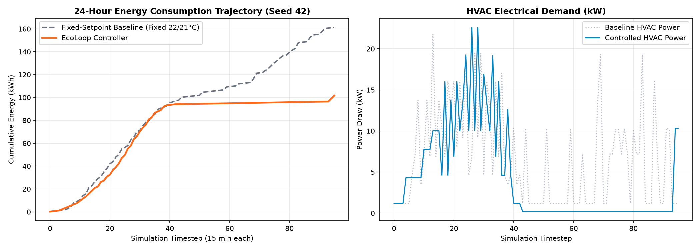

# Eco-Loop System Evaluation Report

> **Generated:** 2026-11-25 19:15:07 UTC
> **Evaluation Scope:** 24 simulated hours (96 timesteps × 15 min) | Seeds: `[42, 101, 2024]` | CO₂ Factor: 0.386 kg/kWh
> **Active Dynamic Controller Under Test:** `Rule-Based Dynamic Controller (Deterministic Algorithm)`

## 1. Executive Summary & Balanced Baseline Comparison

This evaluation measures the performance of the Eco-Loop autonomous controller against a fixed-setpoint reference baseline (cooling 22°C, heating 21°C). Thermal state, envelope parameters, weather, and occupancy are matched by seed; setpoints differ by controller. The live controller's validation, slew limits, and fan actuation are used.

| Metric                           | Reference Baseline (Fixed 22/21°C)   | Eco-Loop Controlled   | Delta / Impact                |
|----------------------------------|--------------------------------------|-----------------------|-------------------------------|
| Total Energy (Mean ± Std)        | 160.90 ± 2.33 kWh                    | 102.41 ± 0.72 kWh     | -36.34% ± 0.92% energy change |
| Peak Electrical Demand           | 21.00 kW                             | 22.61 kW              | +7.98% demand change          |
| Avoided COâ‚‚ Emissions (24 h)     | Reference (0.00 kg)                  | 22.58 kg              | +22.58 kg avoided             |
| PMV Comfort Target (|PMV| ≤ 0.5) | 50.9% ± 0.7%                         | 63.1% ± 0.4%          | +12.2 percentage points       |
| Mean PMV (Comfort Index)         | -0.586                               | -0.125                | -0.461 drift from neutral     |
| Predicted Dissatisfied (PPD)     | 13.4%                                | 11.1%                 | -2.3 points                   |

### Multi-Seed Breakdown (24-Hour Simulation Across Seeds)

|   Seed | Controller Mode               |   Base (kWh) |   Ctrl (kWh) | Savings (%)   |   COâ‚‚ Avoided (kg) | Peak Red. (%)   | Base Comfort   | Ctrl Comfort   |   Ctrl PMV |
|--------|-------------------------------|--------------|--------------|---------------|--------------------|-----------------|----------------|----------------|------------|
|     42 | Rule-Based Dynamic Controller |       161.29 |       101.65 | +37.0%        |              23.02 | -3.9%           | 50.2%          | 63.1%          |      -0.13 |
|    101 | Rule-Based Dynamic Controller |       163.01 |       103.08 | +36.8%        |              23.13 | -16.1%          | 50.8%          | 62.7%          |      -0.13 |
|   2024 | Rule-Based Dynamic Controller |       158.4  |       102.51 | +35.3%        |              21.57 | -3.9%           | 51.7%          | 63.5%          |      -0.12 |

## 2. Matched Head-to-Head Comparison (Identical 5 Timesteps, Seed 42)

The available control approaches share seeded thermal conditions for five timesteps starting at 2024-01-01 08:00. Live LLM results are omitted when its configured model is unavailable.

| Metric                           | Fixed Baseline   | Rule-Based Dynamic   | Live LLM (qwen2.5:1.5b)   |
|----------------------------------|------------------|----------------------|---------------------------|
| Total Energy Consumed            | 1.48 kWh         | 2.27 kWh             | N/A                       |
| Energy Savings vs Baseline       | Reference (0.0%) | -52.8%               | N/A                       |
| PMV Comfort Target (|PMV| ≤ 0.5) | 4.0%             | 4.0%                 | N/A                       |
| Mean PMV (Comfort Index)         | -0.704           | -0.704               | N/A                       |
| Mean PPD (% Dissatisfied)        | 15.8%            | 15.8%                | N/A                       |
| Controller Fallback Count        | N/A              | 0 (Algorithmic)      | N/A                       |
| Average Decision Latency         | 0.00 ms          | 0.00 ms              | N/A                       |
| Actuator Setpoint Modifications  | 0 (Static)       | 6 updates            | N/A                       |

> [!NOTE]
> **Scope**: This short comparison starts at 2024-01-01 08:00 and covers five timesteps. It cannot establish day-long LLM energy or comfort performance.

## 3. In-Process MCP Tool Function Latency (N=50 Repetitions)

> [!NOTE]
> **Transport Scope**: These benchmarks measure in-process Python tool execution. Serialization, IPC, HTTP, and network latency are not measured.

| Tool Name              |   N | Median   | Mean     | P95      | Min      | Max      | Status   |
|------------------------|-----|----------|----------|----------|----------|----------|----------|
| read_building_state    |  50 | 0.008 ms | 0.009 ms | 0.012 ms | 0.006 ms | 0.033 ms | Success  |
| get_hvac_setpoints     |  50 | 0.017 ms | 0.017 ms | 0.018 ms | 0.015 ms | 0.041 ms | Success  |
| update_setpoint        |  50 | 0.029 ms | 0.032 ms | 0.057 ms | 0.019 ms | 0.099 ms | Success  |
| update_all_setpoints   |  50 | 0.080 ms | 0.090 ms | 0.145 ms | 0.073 ms | 0.408 ms | Success  |
| run_simulation_step    |  50 | 0.319 ms | 0.354 ms | 0.598 ms | 0.281 ms | 0.884 ms | Success  |
| get_energy_usage       |  50 | 0.008 ms | 0.008 ms | 0.010 ms | 0.007 ms | 0.022 ms | Success  |
| calculate_savings      |  50 | 0.007 ms | 0.007 ms | 0.008 ms | 0.006 ms | 0.010 ms | Success  |
| get_comfort_report     |  50 | 0.006 ms | 0.007 ms | 0.008 ms | 0.006 ms | 0.016 ms | Success  |
| get_outdoor_conditions |  50 | 0.004 ms | 0.004 ms | 0.005 ms | 0.004 ms | 0.018 ms | Success  |
| get_ai_decision        |  50 | 0.002 ms | 0.003 ms | 0.004 ms | 0.002 ms | 0.006 ms | Success  |

## 4. Fault Tolerance & Actuation Resilience

Evaluation of controller behavior under injected physical, network, and model failure modes:

| Fault Scenario                      | Handler Action                      | Verification Result                                              |
|-------------------------------------|-------------------------------------|------------------------------------------------------------------|
| LLM Network Disconnect              | 5/5 Fallback Actions                | Fallback after real port connection refusal                      |
| LLM Request Timeout                 | 5/5 Fallback Actions                | Fallback after forced HTTP failure (timeout or connection error) |
| Malformed Model Response            | 5/5 Fallback Actions                | Schema validation and fallback path exercised                    |
| Fallback Actuator Actuation         | 5 zone requests sent                | Passed (Actuators received and applied fallback setpoints)       |
| Sensor Dropout (NaN / Disconnect)   | Anomalous reading flagged & imputed | Passed (Comfort scores calculable without numerical error)       |
| Polar Vortex Freeze (-20°C ambient) | Heating Floor Maintained            | Passed (Indoor T ≥ 16.0°C across all zones)                      |

## 5. Deployment Health & Resource Usage

| System Component         | Observed State                                                                                |
|--------------------------|-----------------------------------------------------------------------------------------------|
| Host CPU Utilization     | 35.3%                                                                                         |
| Process Memory (RSS RAM) | 149.3 MB                                                                                      |
| Local Ollama Server      | Offline                                                                                       |
| Verified LLM Model       | Unavailable (not verified)                                                                    |
| Simulation Engine        | Synthetic Python thermal model with PMV/PPD estimates (EnergyPlus is not run by this harness) |

## 6. Methodology & Empirical Limitations

- **Matched Evaluation**: Reference fixed baseline and controlled environments share identical building dimensions, thermal mass coefficients ($1.8\times 10^7$ to $4.5\times 10^7$ J/K), weather profiles, and occupant density.
- **Emission Modeling**: COâ‚‚ calculations use an un-clamped factor of 0.386 kg/kWh, preserving negative emissions penalties whenever a controller consumes more energy than the baseline.
- **Comfort Scope**: The PMV neutral target ($-0.5 \le \text{PMV} \le +0.5$) is sampled across all zones, including unoccupied periods. This metric does not establish full ASHRAE 55 compliance.
- **Extrapolation Bounds**: Results describe only the configured synthetic simulation period. Annual and physical-building performance require separate validation.

## Visualization

