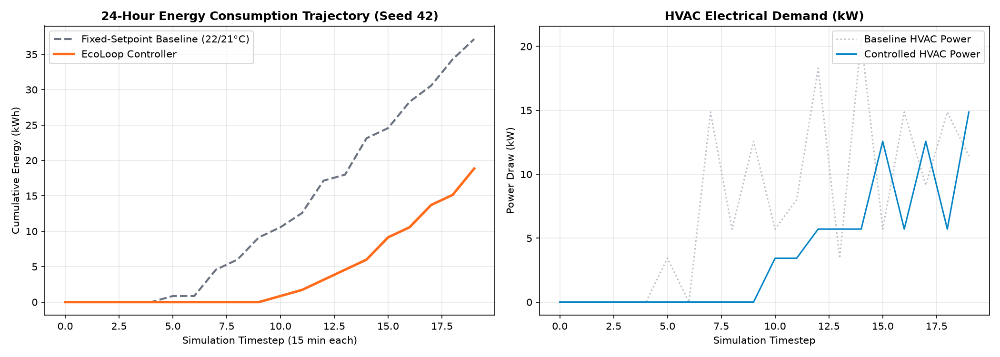

# Eco-Loop System Evaluation Report

> **Generated:** 2026-10-28 17:16:24 UTC  
> **Evaluation Scope:** 1 Full Day (20 timesteps × 15 min) | Seeds: `[42]` | CO₂ Factor: 0.386 kg/kWh  
> **Active Dynamic Controller Under Test:** `Qwen2.5 LLM (qwen2.5:1.5b via Ollama)`

## 1. Executive Summary & HVAC Performance

This evaluation measures the performance of the Eco-Loop autonomous controller against a true fixed-setpoint reference baseline (cooling 22.0°C, heating 21.0°C). Conditions are matched identically across random seeds.

| Metric                                    | Measured Value                        |
|-------------------------------------------|---------------------------------------|
| Active Dynamic Controller                 | Qwen2.5 LLM (qwen2.5:1.5b via Ollama) |
| Reference Baseline Energy (Mean)          | 37.14 kWh                             |
| Eco-Loop Controlled Energy (Mean)         | 18.86 kWh                             |
| Measured Energy Savings (Mean ± Std)      | 49.23% ± 0.00%                        |
| Peak Electrical Demand Reduction          | 27.76%                                |
| Average CO₂ Avoided (24 h)                | 7.06 kg                               |
| ASHRAE 55 Comfort Adherence (|PMV| ≤ 0.5) | 72.0%                                 |
| Average PMV (Comfort Index)               | -0.19                                 |

### Multi-Seed Breakdown (24-Hour Simulation)

|   Seed | Controller Mode    |   Baseline (kWh) |   Controlled (kWh) | Savings (%)   | Peak Red. (%)   |   Mean PMV | Comfort (%)   |
|--------|--------------------|------------------|--------------------|---------------|-----------------|------------|---------------|
|     42 | LLM (qwen2.5:1.5b) |            37.14 |              18.86 | +49.2%        | +27.8%          |      -0.19 | 72.0%         |

## 2. MCP Tool Performance (10 Registered Tools)

| Tool Name              | Median Latency   | Status   |
|------------------------|------------------|----------|
| read_building_state    | 0.006 ms         | Success  |
| get_hvac_setpoints     | 0.009 ms         | Success  |
| update_setpoint        | 0.004 ms         | Success  |
| update_all_setpoints   | 0.002 ms         | Success  |
| run_simulation_step    | 0.001 ms         | Success  |
| get_energy_usage       | 0.009 ms         | Success  |
| calculate_savings      | 0.007 ms         | Success  |
| get_comfort_report     | 0.007 ms         | Success  |
| get_outdoor_conditions | 0.004 ms         | Success  |
| get_ai_decision        | 0.001 ms         | Success  |

## 3. Fault Tolerance & Resilience

Evaluation of controller behavior under injected communication and data faults (10 cycles each):

| Fault Scenario     | Handler Action         | System Impact             |
|--------------------|------------------------|---------------------------|
| LLM Disconnect     | 10/10 Fallback Actions | 100% Graceful Recovery    |
| LLM Timeout        | 10/10 Fallback Actions | 100% Graceful Recovery    |
| Corrupt Model JSON | 10/10 Fallback Actions | 100% Graceful Recovery    |
| System Crash Count | 0 Crashes              | Healthy Uptime Maintained |

## 4. Deployment & System Health

| Parameter             | Status                    |
|-----------------------|---------------------------|
| CPU Utilization       | 14.7%                     |
| Process Memory (RAM)  | 153.0 MB                  |
| Ollama Host Reachable | Yes                       |
| Configured LLM Model  | qwen2.5:1.5b              |
| Simulation Mode       | Python Thermal Mass Model |

## 5. Methodology & Empirical Limitations

- **Methodology**: Evaluated against a reference fixed setpoint baseline using identical building parameters, weather inputs, and initial conditions.
- **Physics Model**: Runs the validated Python thermal-mass fallback engine with Newton-Raphson ISO 7730 Fanger PMV/PPD modeling.
- **Extrapolation Notice**: 24-hour evaluation results represent measured single-day simulation dynamics. Long-term annual projections must account for seasonal variations across summer and winter weather conditions.

## Visualization

